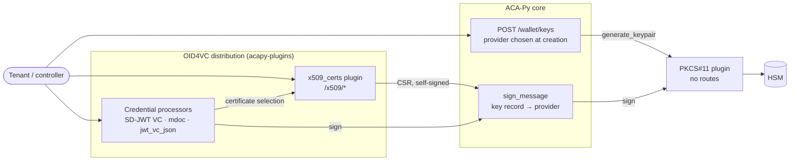
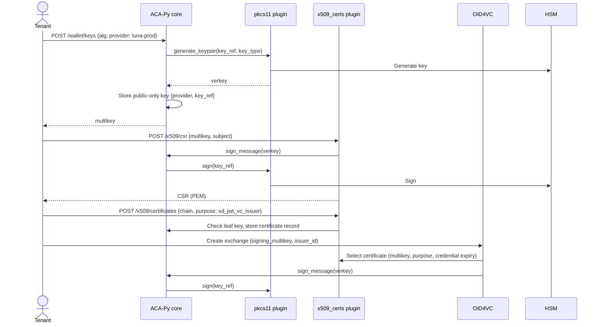

# OID4VC Issuer Keys and X.509 Certificates

## Goal

Issue OID4VC credentials, SD-JWT VC first and then mdoc, with keys held either in a hardware security module (HSM) through PKCS#11 or in the Askar wallet, without requiring DIDs. Private key material for HSM keys never enters the wallet.

## Requirements

| Area | Operations |
| --- | --- |
| Custody | Create a key in the wallet or the HSM, sign with it, address it by multikey |
| X.509 | Build a CSR, import a CA-issued chain whose leaf matches a wallet key, query certificates, manage trust anchors, verify chains, self-sign for demos |
| Issuance | Select the issuer key by multikey and embed a certificate whose validity covers the credential |

Existing DID-based issuance keeps working.

## Overview



## ACA-Py Core

Repository: ACA-Py.

### Key creation

`POST /wallet/keys` gains an optional `provider`: the name a backend plugin registered its `Signer` under. The provider is chosen when the key is created and never changes; changing custody means creating a new key. There is no `options` field for now.

| Request | Result |
| --- | --- |
| `{"alg": "p256"}` | Unchanged: an Askar key pair, stored under its base58 verkey with a `multikey` tag |
| `{"alg": "p256", "provider": "luna-prod"}` | Core validates the request (provider registered, provider supports `alg`, no `seed`), generates `key_ref`, calls the provider's `generate_keypair`, then stores a public-only key record with `provider` and `key_ref` in its metadata. Validation happens before the provider call, so a rejected request leaves no orphan HSM key |

An optional `kid` is set in the same insert, so it never goes through `assign_kid_to_key`.

### Provider interface

The existing `Signer` protocol gains `generate_keypair(key_ref, key_type) -> verkey` beside `sign(key_ref, message, key_type)`. A backend plugin registers one `Signer` in `SignerRegistry` under its provider name, and the key record's `provider` field names it for both creation and signing.

### Signing

`sign_message(verkey)` finds the provider from the key record (`get_signing_key(verkey)` metadata), not from a DID record. Keys without `provider` sign in-wallet as today.

### Key record metadata

| Field | Written by | Read by |
| --- | --- | --- |
| `provider` | Core, at creation | Core, signer dispatch |
| `key_ref` | Core, at creation | The provider, through `Signer.sign` |

```json
{ "provider": "luna-prod", "key_ref": "6f1c2e0a-4b7d-4c1e-9a3f-2d8e5b7c9a10" }
```

Certificates are not stored in key metadata.

### Fixes

- `assign_kid_to_key` calls `update_key` without metadata. In Askar this clears the key's metadata, removing `provider` and `key_ref`, which leaves an HSM key unusable. Kanon uses the same call pattern and also replaces all tags with `{"kid": kid}`. Both must preserve metadata, and Kanon must merge tags. Callers include `PUT /wallet/keys`, core `jwt_sign`, LD-proof signing in `vc_ld`, and `DefaultVerificationKeyStrategy`.
- Metadata updates must not overwrite `provider` or `key_ref`.
- Remove the uncommitted DID rotation guard (`_ensure_local_rotation_allowed`). No DID record points at an HSM key, so DID rotation cannot reach one.

## PKCS#11 Plugin

Repository: acapy-plugins (new plugin, replaces KMSLITE). No HTTP routes.

- Registers its `Signer` (`generate_keypair` and `sign`) under the provider name from its configuration at startup.
- Configuration separates the provider name from the protocol: for example `provider: luna-prod`, `protocol: pkcs11`, plus the PKCS#11 settings (library path, token, PIN source, slot).
- Backend settings are deployment configuration, shared by all tenants.

## X.509 Plugin

Repository: acapy-plugins. A plugin package named `x509_certs` in the OID4VC distribution, beside `mso_mdoc`, loaded with `--plugin x509_certs`. The name avoids a clash with the `x509` package on PyPI.

| Endpoint | Purpose |
| --- | --- |
| `POST /x509/csr` | A wallet key signs the CSR; returns PEM |
| `POST /x509/certificates` | Import an externally issued chain; the leaf must match a wallet key |
| `GET /x509/certificates` | List; filter by `multikey`, `kid`, `subject`, `valid_at`, `purpose` |
| `GET /x509/certificates/{cert_id}` | Chain plus parsed subject, issuer, validity, and SANs |
| `DELETE /x509/certificates/{cert_id}` | Remove a certificate |
| `POST /x509/certificates/self-signed` | Demo and development only; a wallet key signs its own certificate |
| `POST /x509/trust-anchors` | Import a root or intermediate, tagged by purpose |
| `GET /x509/trust-anchors` | List; filter by `purpose`, `subject` |
| `GET /x509/trust-anchors/{anchor_id}` | Anchor plus parsed details |
| `DELETE /x509/trust-anchors/{anchor_id}` | Remove a trust anchor |
| `POST /x509/verify` | Verify a chain for a certificate purpose against the trust anchors of the matching anchor purpose |

### Records

- Certificate record: `cert_id`, tags `multikey`, `purpose`, `subject`, `not_before`, `not_after`; value holds the chain in JWS `x5c` format (standard base64 DER, leaf first) and the parsed issuer and SANs. A key can have several certificates, for renewal or different purposes.
- Trust-anchor record: `anchor_id`, tags `purpose` (required), `subject`. Adopt the existing `TrustAnchorRecord` schema where it fits. Records already stored by `mso_mdoc` are not migrated.
- The `kid` filter resolves to a multikey through the key's `kid` tags when listing; certificate records do not store `kid`.
- All records are per tenant: routes use `tenant_authentication` and store in the calling tenant's wallet.

### Purposes

Certificates and trust anchors each require a purpose from a fixed list; other values are rejected. Certificate purposes name the leaf's role, and anchor purposes name the CA role, following ISO 18013-5's IACA (Issuing Authority CA). No specification names the CA for SD-JWT VC issuers: SD-JWT VC leaves it to policy and HAIP 1.0 calls it a trust anchor.

| Certificate purpose | Meaning | Verified against anchor purpose |
| --- | --- | --- |
| `mdoc_ds` | mdoc document-signer certificate | `iaca` (mdoc issuing root) |
| `sd_jwt_vc_issuer` | SD-JWT VC issuer certificate | `sd_jwt_vc_ca` |

`POST /x509/verify` takes a certificate purpose and uses only anchors with the matching anchor purpose. The issuer needs no trust anchors to issue; anchors are for verification.

### Self-signed certificates

`POST /x509/certificates/self-signed` is disabled unless a plugin setting enables it. HAIP 1.0 (Section 6.1.1) forbids a self-signed certificate signing an SD-JWT VC, so these certificates are for demos only.

### Moving into ACA-Py later

If X.509 is needed outside OID4VC, the package moves to `acapy_agent.x509`. To keep that a rename:

- Use relative imports inside the package.
- Other packages import only from the package entry point.
- Do not import other OID4VC modules.
- Keep record types, tags, and `/x509` paths stable.

At the move, the OID4VC distribution stops registering `/x509` routes, keeps a re-export for existing imports, and raises its required `acapy-agent` version.

## OID4VC Today

The credential processors select the issuer key only through a DID:

| Processor | Key selected by | Certificate | Header |
| --- | --- | --- | --- |
| `mso_mdoc` | `vc_additional_data.issuer_did` on the supported credential | `x509_certificate_pem` in DID metadata | n/a |
| `sd_jwt_vc` | Exchange `did` or `verification_method` | Static `vc_additional_data.x5c_cert_chain` | `x5c` if configured, else `kid` |
| `jwt_vc_json` | Exchange `did` or `verification_method` | None | `kid` |

The OID4VC `jwt_sign` looks the key up with `wallet.get_local_did`, so it requires a DID record. Exchange creation already handles `did:jwk` without resolution (`verification_method = f"{did}#0"`, `issuer_id = did`).

## Credential Processors

### Signing key

The exchange provides the signing key for all three processors. The supported credential defines the credential, not how it is signed.

| Path | Signing key given as | Certificates found by |
| --- | --- | --- |
| Multikey (recommended for new users) | `signing_multikey` on the exchange | The multikey |
| DID (backward compatibility) | Exchange `did` or `verification_method`: `did:jwk` or `did:web` | Not selected; SD-JWT VC keeps today's static `x5c_cert_chain` or `kid`. Not available for `mso_mdoc`, which always needs a certificate |

If `signing_multikey` is present, it is used and `did`/`verification_method` are ignored for signing.

### Certificate selection

At issuance on the multikey path, after computing the credential's expiry, the processor:

1. Queries certificate records for the signing multikey and its purpose (`sd_jwt_vc_issuer` or `mdoc_ds`).
2. Keeps those with `not_before` ≤ now and `not_after` ≥ the credential's expiry.
3. Picks the one with the earliest `not_after`; on a tie, the earlier `not_before`.
4. Fails the issuance if none qualifies.

SD-JWT VC puts the chain in the `x5c` header; mdoc passes it as PEM for `x5chain`. `jwt_vc_json` embeds no certificate. The embedded chain leaves out a self-signed root at its end, because HAIP 1.0 (Section 6.1.1) forbids the trust anchor in `x5c`; the stored chain may include it.

For mdoc, isomdl sets the MSO validity (30 days in `isomdl-uniffi` 0.1.0), so the certificate is selected after the mdoc is prepared, using `validityInfo.validUntil` read from the payload to be signed.

### Changes

| Where | Change |
| --- | --- |
| Exchange creation | Add optional `signing_multikey` and `issuer_id`. If `signing_multikey` is present, use it; `issuer_id` is required only for `jwt_vc_json`. Otherwise require `did` or `verification_method` and behave as today; `mso_mdoc` exchanges require `signing_multikey`. Make the exchange record's `verification_method` and `issuer_id` optional. |
| `jwt_sign` | Add an optional keyword `verkey`: read the key type from `get_signing_key`, sign with `sign_message`, and add no `kid` unless the caller supplies one. For a `did:jwk` with no DID record, decode the JWK from the identifier to get the verkey; a DID record, when present, is used first. |
| `sd_jwt_sign` | Pass `verkey` through as a keyword. |
| `sd_jwt_vc` | On the multikey path, use certificate selection for `x5c`; without a qualifying certificate the issuance fails, since the credential would carry neither `x5c` nor `kid`. A static `x5c_cert_chain` in the supported credential still takes precedence. Omit `iss` when the exchange has no `issuer_id`. |
| `jwt_vc_json` | On the multikey path, call `jwt_sign(verkey=...)` with `iss` and `vc.issuer` set to `issuer_id`. |
| `mso_mdoc` | Sign with the exchange's `signing_multikey`, which must be P-256. Remove `issuer_did` from `vc_additional_data` and its route schemas. Remove the device-key fallback to the exchange `verification_method`; the holder must supply the device key in the proof. Use certificate selection; remove the `x509_certificate_pem` DID-metadata lookup, which has no production data. Verify against `x509_certs` trust anchors with purpose `iaca`. |

Compatibility:

- `jwt_vc_json` and `sd_jwt_vc`: additive. Requests without `signing_multikey` behave as today.
- `mso_mdoc`: breaking. The supported credential's `issuer_did` is no longer read; exchanges must give `signing_multikey`, and issuance fails if the holder supplies no device key.
- Stored records load through the record constructor, not the schema (`BaseRecord.from_storage`). Old exchange records load under the new code. After a rollback, the old constructor raises `TypeError` on any stored `signing_multikey` key, so the record stores it only when set: DID-path records still load, and multikey-path records do not.

## DIDs

Future OID4VC issuance does not depend on DIDs. For backward compatibility, the DID path supports `did:jwk` and `did:web` without DID records in ACA-Py; the private key lives in the wallet key record (Askar or HSM).

| | `did:jwk` | `did:web` |
| --- | --- | --- |
| Key → DID | Computed from the multikey's public key, using the JWK without `"use"` | Publish a DID document listing the public key, for example `did:web:example.com#key-1` |
| DID → key at issuance | Decode the JWK from the identifier, then convert it to a multikey | Bind the `kid` once with `PUT /wallet/keys`, then look the key up locally, so issuance does not depend on the host |
| Record in ACA-Py | None | The `kid` tag on the key record |

- Binding a `kid` depends on the `assign_kid_to_key` fix; without it, binding erases an HSM key's `provider` and `key_ref`.
- The OID4VC plugin's existing `POST /did/jwk/create` stays for existing users. It stores the key under its JWK thumbprint, so the key works through the DID record but cannot be found by multikey.
- No DID linking route, no DID rotation to an existing key, and no rotation guard.

## mso_mdoc Cleanup

- `mso_mdoc` signs only with wallet keys, Askar or HSM.
- Its certificate, key, and trust-anchor endpoints are removed: `/mso-mdoc/signing-keys` and `/mso-mdoc/trust-anchors`, with their records.
- mdoc verification reads `x509_certs` trust anchors with purpose `iaca` only, as it read `mso_mdoc` anchors before.
- For upstream users of `/mso-mdoc/signing-keys` this is a breaking change: private keys are not imported, so they create new wallet or HSM keys and obtain new certificates. Anchors stored through `/mso-mdoc/trust-anchors` are re-imported through `/x509/trust-anchors`.

## End-to-End Flow (SD-JWT VC, HSM key)



## Issuer Identity and Verification

### SD-JWT VC with inline X.509

- The protected `x5c` chain supplies the issuer's verification key, and the issuer identity is the leaf certificate's subject. The `iss` claim is optional when identity is conveyed this way; do not derive `iss` from a DID by default.
- Set `typ` to `dc+sd-jwt`. The processor takes `typ` from the supported credential's `format` (`vc+sd-jwt` or `dc+sd-jwt`).
- Do not add a DID-based `kid` beside `x5c`. The draft does not prohibit both, but a `kid` must not redirect verification away from the certificate trust path. The OID4VC `jwt_sign` already omits `kid` when `x5c` is set.
- The holder's `cnf.x5c`, when present, describes the holder key and is unrelated to the issuer's protected-header `x5c`.
- The HTTPS `iss` / JWT VC issuer metadata mechanism is a separate SD-JWT VC key-discovery path. A DID-based mechanism can be an ecosystem extension; neither is required for the inline-certificate path. See [SD-JWT VC draft, Section 2.5](https://datatracker.ietf.org/doc/html/draft-ietf-oauth-sd-jwt-vc-19#section-2.5).

### Verification

Verification must validate the signature and the certificate chain under the applicable trust policy. Matching the leaf public key when a certificate is imported does not establish issuer trust. The OID4VC `jwt_verify` checks an `x5c` signature against the leaf in the token only, with no chain or trust-anchor validation; verifiers use `POST /x509/verify` with the trust anchors for the purpose.

### `jwt_vc_json`
 (see Issuer Identity and Verification)
- A DID is not mandated by [W3C VC Data Model v1.1](https://www.w3.org/TR/vc-data-model/#issuer) or [OID4VCI 1.0 Appendix A.1.1](https://openid.net/specs/openid-4-verifiable-credential-issuance-1_0.html#appendix-A.1.1); a URI such as an HTTPS issuer is permitted.
- Set the VC `issuer` and JWT `iss` to that issuer identifier, independently of the signing multikey and the OID4VCI Credential Issuer Identifier.
- A DID-free profile needs an interoperable definition of how the JWT's key identifier resolves to a verification key, how that key is bound to the issuer URI, and how the verifier establishes trust. Signing with a selected wallet key alone is insufficient.
- SD-JWT VC's inline-`x5c` issuer rule does not automatically apply to `jwt_vc_json`, and attaching a chain does not by itself establish issuer binding and trust.

## Security and Multitenancy

- Core generates `key_ref`, for example as a UUID; requests never carry one. A client-supplied `key_ref` would let a tenant probe for another tenant's labels, and a check-then-create on the label can race because PKCS#11 does not require unique labels.
- Every route uses `tenant_authentication`; key, certificate, and trust-anchor records are stored in the calling tenant's wallet.
- Backend settings are deployment configuration and never stored in key or certificate records.
- Self-signed certificates are disabled by default.
- A public-only key without a `provider` cannot sign; with Askar, `sign_message` fails with a generic `WalletError`.

## Out of Scope

- Importing private keys.
- Key deletion (ACA-Py has none today).
- Moving OID4VP's `x509_identity` onto the `/x509` records.
- DID rotation.
- Deployment-wide trust anchors.
- A DID-free issuer verification profile for `jwt_vc_json`.

## Alternatives Considered

| Alternative | Why not chosen |
| --- | --- |
| Certificate in key metadata (`PATCH /wallet/keys/{multikey}` or `/wallet/keys/{multikey}/certificate`) | One chain per key; no query, trust anchors, or verification |
| X.509 in ACA-Py core (`/wallet/x509/*`) | Harder to get approved; only OID4VC needs X.509 today. Can move later |
| X.509 as a separate distribution | Installing mdoc would require installing another distribution |
| X.509 as a submodule of the `oid4vc` package | Not loadable on its own; a sibling plugin moves to ACA-Py with a rename |
| `cert_id` in the credential configuration | Cannot satisfy the rule that the certificate must cover the credential's expiry |
| Plugin routes for HSM keys (`/pkcs11/keys`, `/pkcs11/dids`) | Each backend would repeat key and DID routes; choosing the provider at creation in core was preferred |
| Separate `KeyProvider` and `Signer` interfaces | Two registrations per plugin with nothing tying them together |
