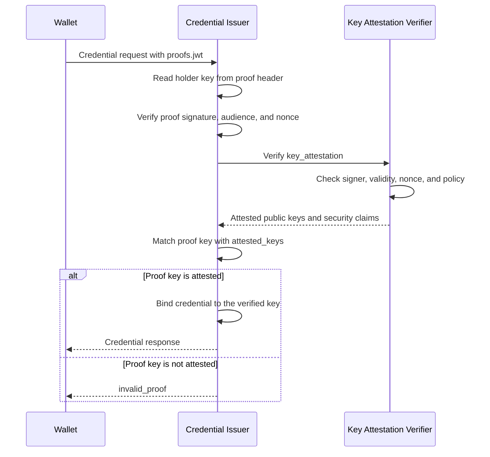
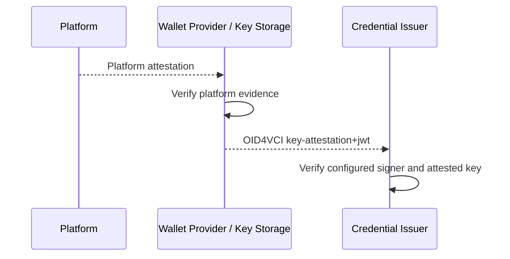
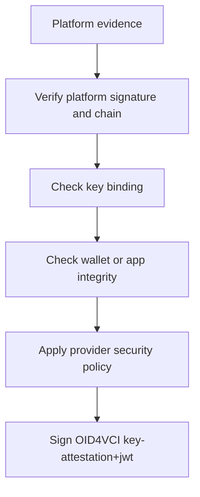

# OID4VCI Key Attestation

## Status

Proposed implementation design for OpenID for Verifiable Credential Issuance 1.0.

The linked specification defines key attestations in Appendix D and uses them in
Appendix F. This document covers key attestation at the OID4VCI Credential Endpoint
as an extension to the proof-of-possession implementation already used by this
plugin. A key attestation describes the security properties of a public key and its
key storage component; the OID4VCI proof continues to demonstrate control of the
corresponding private key.

## Objective

Allow a Credential Issuer to require or evaluate evidence that the key to which a
credential is bound satisfies a defined key-storage and user-authentication policy.
The implementation must bind the attestation to the same key used by the issuance
proof and must never accept private key material.

## OID4VCI protocol surface

A Credential Issuer declares requirements per credential configuration and proof type:

```json
{
  "credential_configurations_supported": {
    "IdentityCredential": {
      "format": "dc+sd-jwt",
      "cryptographic_binding_methods_supported": ["jwk"],
      "proof_types_supported": {
        "jwt": {
          "proof_signing_alg_values_supported": ["ES256"],
          "key_attestations_required": {
            "key_storage": ["iso_18045_moderate"],
            "user_authentication": ["iso_18045_moderate"]
          }
        }
      }
    }
  }
}
```

`key_attestations_required` is omitted when no key attestation is required. An empty
object means that an attestation is required without an additional storage or user
authentication constraint.

The OID4VCI 1.0 specification defines two ways to send an attestation:

1. `jwt` proof: the proof JWT carries `key_attestation` in its JOSE header. The JWT
   proves possession of one attested key.
2. `attestation` proof: the `proofs.attestation` array contains exactly one key
   attestation JWT. This supplies attestation for one or more keys without proving
   possession of those keys in that request.

For this repository, key attestation should be added to the existing `jwt` proof
implementation. The current Credential Endpoint already accepts `proofs.jwt`,
extracts the holder key, verifies the proof signature, validates the audience and
nonce, and passes the resulting `PopResult` to credential processors. Key-attestation
validation extends this path; it does not introduce a second authentication flow.

Standalone `attestation` proofs can be added as a separate follow-up once the
issuer's credential-binding behavior for keys without a proof is defined.

## Key-attestation JWT

The key attestation is a compact JWS with these requirements:

- JOSE `typ` is `key-attestation+jwt`.
- JOSE `alg` is an approved asymmetric algorithm, never `none` or a symmetric MAC.
- The signature key is conveyed using `x5c`, `kid`, or `trust_chain`, according to
  the issuer's trust configuration.
- `iat` is required.
- `exp` is optional in the attestation format, but is required when the attestation
  is used with a `jwt` proof.
- `attested_keys` is a required non-empty array of public JWKs.
- `key_storage` and `user_authentication` are optional arrays of policy values.
- `nonce` is optional unless the issuer supplied a nonce; then it must equal the
  server-provided `c_nonce`.
- `certification` and `status` are optional.

Example decoded payload:

```json
{
  "iss": "https://wallet-provider.example",
  "iat": 1735689600,
  "exp": 1735693200,
  "attested_keys": [
    {
      "kty": "EC",
      "crv": "P-256",
      "x": "...",
      "y": "..."
    }
  ],
  "key_storage": ["iso_18045_moderate"],
  "user_authentication": ["iso_18045_moderate"],
  "nonce": "server-issued-c_nonce"
}
```

The initial policy vocabulary defined by the specification is:

- `iso_18045_high`
- `iso_18045_moderate`
- `iso_18045_enhanced-basic`
- `iso_18045_basic`

Unknown policy values may be accepted only when explicitly configured by the
deployment. They must not be interpreted as stronger than their documented meaning.

## Request examples

### JWT proof with key attestation

```json
{
  "credential_configuration_id": "IdentityCredential",
  "proofs": {
    "jwt": ["<proof-jwt>"]
  }
}
```

The proof JWT has a header similar to:

```json
{
  "typ": "openid4vci-proof+jwt",
  "alg": "ES256",
  "jwk": { "kty": "EC", "crv": "P-256", "x": "...", "y": "..." },
  "key_attestation": "<key-attestation-jwt>"
}
```

The proof JWT must contain `aud` equal to the Credential Issuer Identifier, `iat`,
and `nonce` when the issuer uses a nonce endpoint. The proof signature must verify
with the key identified by `jwk`, `kid`, or `x5c`.

### Standalone attestation proof

```json
{
  "credential_configuration_id": "IdentityCredential",
  "proofs": {
    "attestation": ["<key-attestation-jwt>"]
  }
}
```

This form does not prove possession of an attested key. The issuer must therefore
choose how the issued credential is bound to one of `attested_keys`, or reject this
proof type for credential configurations that require proof of possession.

## Validation algorithm

For a `jwt` proof, validation should happen in this order:

1. Parse the proof as a compact JWS and reject malformed serialization.
2. Validate the proof `typ`, asymmetric `alg`, required claims, issuer audience, and
   nonce freshness.
3. Resolve the proof key from `jwk`, `kid`, or `x5c`. Reject conflicting key
   identifiers and private JWK members.
4. Verify the proof signature with the resolved public key.
5. If `key_attestation` is present, parse it as a compact JWS and require
   `typ=key-attestation+jwt`.
6. Resolve and verify the attestation signer against configured trust anchors. The
   issuer must not trust an arbitrary key included by the wallet unless that key is
   authenticated by the configured trust mechanism.
7. Validate `iat`, `exp`, and the configured clock-skew window. Require `exp` for a
   `jwt` proof.
8. If the issuer supplied `c_nonce`, require the attestation `nonce` to match it.
9. Validate every JWK in `attested_keys` as public key material and reject private
   parameters such as `d`, `p`, `q`, `dp`, `dq`, or `qi`.
10. Require the proof key to match an entry in `attested_keys` using an RFC 7638 JWK
    thumbprint. Do not compare serialized JSON.
11. Require `key_storage` and `user_authentication` to satisfy
    `key_attestations_required`. A missing claim fails a policy that requires it.
12. Apply status or revocation checks when the selected attestation profile supports
    them.
13. Pass the verified holder key and normalized attestation result to the credential
    processor. The processor binds the issued credential to the proof key.

If `key_attestations_required` is present and the proof has no key attestation, the
request must fail with `invalid_proof`. An invalid or insufficient attestation must
not be silently treated as an unattested request.

## OID4VCI proof flow

The key attestation is evaluated inside the existing proof-of-possession flow. It is
not a separate endpoint or authentication flow.



The standalone `attestation` proof type follows the same attestation validation
steps, but does not include proof-of-possession for the key. Its credential-binding
behavior must therefore be defined separately before it is enabled.

## Sample request and response payloads

### Credential request

The wallet sends the key proof in the standard OID4VCI `proofs.jwt` array. The
`key_attestation` is carried in the proof JWT header, not as a separate top-level
JSON request property.

```json
{
  "credential_configuration_id": "IdentityCredential",
  "proofs": {
    "jwt": [
      "<compact-proof-jwt-with-key-attestation-header>"
    ]
  }
}
```

For readability, the relevant decoded JOSE header is:

```json
{
  "typ": "openid4vci-proof+jwt",
  "alg": "ES256",
  "jwk": {
    "kty": "EC",
    "crv": "P-256",
    "x": "<proof-key-x>",
    "y": "<proof-key-y>"
  },
  "key_attestation": "<compact-key-attestation-jwt>"
}
```

The proof JWT payload contains the issuer audience, creation time, and server nonce:

```json
{
  "aud": "https://credential-issuer.example.com",
  "iat": 1735689600,
  "nonce": "issuer-nonce-123"
}
```

The decoded key-attestation JWT payload contains the attested public key and its
security properties:

```json
{
  "iss": "https://wallet-provider.example.com",
  "iat": 1735689600,
  "exp": 1735693200,
  "nonce": "issuer-nonce-123",
  "attested_keys": [
    {
      "kty": "EC",
      "crv": "P-256",
      "x": "<proof-key-x>",
      "y": "<proof-key-y>"
    }
  ],
  "key_storage": ["iso_18045_moderate"],
  "user_authentication": ["iso_18045_moderate"]
}
```

The issuer compares the proof JWK with the entries in `attested_keys` using an RFC
7638 JWK thumbprint. The JSON members do not need to use the same ordering.

### Who signs the attestation

Google or Apple may sign the underlying platform evidence. The wallet provider or
key-storage component then issues the OID4VCI `key-attestation+jwt`:



The issuer trusts the OID4VCI signer through `x5c`, `kid`, or `trust_chain`.

### Provider verification responsibilities

The wallet provider or key-storage component should perform these checks before
creating the OID4VCI attestation:



The provider should verify that:

- the platform evidence chains to a trusted Google, Apple, or deployment-specific
  root;
- the public key in the platform evidence is the key placed in `attested_keys`;
- the evidence is intended for the expected wallet application or package;
- the device, app, boot, and user-authentication claims satisfy provider policy;
- the evidence is fresh and has not been revoked or replayed.

The provider then creates the OID4VCI JWT with `attested_keys`, `key_storage`, and
`user_authentication`. The Credential Issuer verifies the provider's signature and
trust configuration; it does not have to understand every platform-specific evidence
format.

### Verification boundary

The checks are split between the provider and the OID4VCI plugin:

| Check | Wallet provider / key storage | OID4VCI plugin |
| --- | --- | --- |
| Google, Apple, or platform certificate-chain validation | Required | Only required when raw platform evidence is accepted directly |
| Platform-specific app, device, boot, or package validation | Required | No |
| Provider security-level decision | Required | Enforce the resulting `key_storage` and `user_authentication` claims |
| OID4VCI attestation JWT signature and trusted signer | Creates signature | Required |
| `typ`, `alg`, `iat`, and `exp` validation | Optional during creation | Required |
| Attestation nonce validation | Include issuer nonce when provided | Required |
| Public `attested_keys` validation | Required before signing | Required |
| Proof key matches `attested_keys` | Should ensure | Required |
| OID4VCI credential binding | No | Required |

In the normal deployment, the plugin does not need Google or Apple SDKs. It trusts
configured provider signing keys and verifies the provider's signed statement. A
deployment that accepts raw Android or Apple attestations directly must add a
platform-specific verifier and trust-root configuration to the plugin.

### Successful credential response

When the proof and key attestation satisfy the configured policy, the issuer returns
the normal OID4VCI credential response. The credential is cryptographically bound to
the verified proof key.

```json
{
  "credentials": [
    {
      "format": "dc+sd-jwt",
      "credential": "<sd-jwt-vc-bound-to-proof-key>"
    }
  ]
}
```

### Invalid key-attestation response

The issuer uses the OID4VCI `invalid_proof` error when the attestation is missing,
invalid, expired, or does not contain the proof key.

```json
{
  "error": "invalid_proof",
  "error_description": "key attestation validation failed"
}
```

## Repository changes

The current implementation in `oid4vc/public_routes/credential.py` normalizes
`proofs.jwt` to one JWT and delegates verification to
`oid4vc/public_routes/token.py:handle_proof_of_posession`. The current proof result
contains the holder key and is consumed by the credential processors, but it does not
yet expose or validate `key_attestation`.

Recommended changes:

1. Extend `PopResult` with an optional normalized `key_attestation` result and the
   attested key thumbprint.
2. Add a key-attestation parser/verifier beside the existing proof verification code.
  Keep trust-anchor and policy resolution injectable so platform-specific formats are
  not embedded in the route.
3. Extract `key_attestation` from the proof JWT header after decoding the header and
  before returning `PopResult`.
4. Add a policy helper that reads `supported.proof_types_supported["jwt"]` and returns
   `key_attestations_required` for the requested credential configuration.
5. Pass that policy into proof verification. Require the attestation only when the
   credential configuration declares it.
6. Preserve the normalized result through credential processing only as needed for
   policy and audit. Do not persist raw JWTs, certificate chains, device identifiers,
   or platform-specific identifiers by default.
7. Add the `attestation` proof type only after defining how its attested keys map to
   the credential binding expected by each processor.
8. Update issuer metadata schemas so `key_attestations_required` survives storage
  and is emitted unchanged.

The existing `SupportedCredential.proof_types_supported` field is already a generic
mapping, so the metadata model likely needs no new top-level field. The main missing
surface is proof extraction, verification, and policy evaluation.

## File change plan

| File | Change | Required | 
| --- | --- | --- |
| `oid4vc/pop_result.py` | Add normalized key-attestation result and matched key thumbprint to `PopResult`. | Yes |
| `oid4vc/public_routes/token.py` | Parse and validate `key_attestation` while verifying the existing proof JWT. | Yes |
| `oid4vc/public_routes/credential.py` | Resolve `key_attestations_required` for the requested credential and pass it to proof validation. | Yes |
| `oid4vc/models/supported_cred.py` | Preserve and emit nested `proof_types_supported` metadata. Update only if round-trip tests expose a schema/storage limitation. | Maybe |
| `oid4vc/routes/supported_credential.py` | Accept the standard nested metadata through the admin API. Update only if request filtering rejects it. | Maybe |
| `oid4vc/key_attestation.py` | Add a dedicated parser, trust resolver, policy evaluator, and normalized result. | Recommended |
| `docs/key-attestation.md` | Keep the protocol and implementation contract current. | Updated |

## Brief code sketches

### Normalized result

`oid4vc/key_attestation.py` should expose a small internal result rather than passing
the raw JWT through the application:

```python
@dataclass(frozen=True)
class KeyAttestationResult:
  format: str
  issuer: str | None
  key_thumbprints: frozenset[str]
  key_storage: frozenset[str]
  user_authentication: frozenset[str]
  expires_at: int
```

The verifier should receive the proof key, attestation JWT, nonce, current time, and
the `key_attestations_required` policy. It should return this result or raise a
domain-specific validation error.

### Proof integration

The existing proof handler already has decoded `headers`, `payload`, and the resolved
`key`. The new call belongs after proof-key resolution and signature verification:

```python
attestation = None
if "key_attestation" in headers:
  attestation = await verify_key_attestation(
    token=headers["key_attestation"],
    proof_key=key,
    nonce=nonce,
    policy=key_attestation_policy,
  )
elif key_attestation_policy is not None:
  raise InvalidProof("required key attestation is missing")

return PopResult(
  headers,
  payload,
  verified,
  holder_kid=headers.get("kid"),
  holder_jwk=holder_jwk,
  holder_x5c=headers.get("x5c"),
  key_attestation=attestation,
)
```

The production implementation should use the repository's existing HTTP error
handling and key APIs rather than introducing the placeholder `InvalidProof` type
shown above.

### `PopResult` extension

```python
@dataclass
class PopResult:
  headers: Mapping[str, Any]
  payload: Mapping[str, Any]
  verified: bool
  holder_kid: Optional[str]
  holder_jwk: Optional[Dict[str, Any]]
  holder_x5c: Optional[List[str]] = None
  key_attestation: Optional[KeyAttestationResult] = None
```

### Credential policy lookup

The Credential Endpoint can derive the policy from the already selected
`SupportedCredential` record:

```python
proof_metadata = (supported.proof_types_supported or {}).get("jwt", {})
key_attestation_policy = proof_metadata.get("key_attestations_required")

pop = await handle_proof_of_posession(
  context.profile,
  proof_value,
  c_nonce,
  key_attestation_policy=key_attestation_policy,
)
```

An absent policy means that an attestation is optional. An empty object means it is
required without storage or user-authentication constraints.

### JWK binding

Use the same canonical public JWK representation for both keys and compare RFC 7638
thumbprints:

```python
proof_thumbprint = jwk_thumbprint(public_jwk(proof_key))
attested_thumbprints = {
  jwk_thumbprint(public_jwk(jwk))
  for jwk in claims["attested_keys"]
}
if proof_thumbprint not in attested_thumbprints:
  raise KeyAttestationError("proof key is not attested")
```

The helper must reject private JWK parameters before calculating the thumbprint.

## Sample code by file

The following snippets are intentionally small and illustrative. They show the
responsibility of each file; names and exception types can be adjusted to match the
final implementation.

### `oid4vc/pop_result.py`

```python
from typing import Optional

from .key_attestation import KeyAttestationResult


@dataclass
class PopResult:
  headers: Mapping[str, Any]
  payload: Mapping[str, Any]
  verified: bool
  holder_kid: Optional[str]
  holder_jwk: Optional[Dict[str, Any]]
  holder_x5c: Optional[List[str]] = None
  key_attestation: Optional[KeyAttestationResult] = None
```

### `oid4vc/key_attestation.py`

```python
async def verify_key_attestation(
  token: str,
  proof_key: Key,
  nonce: str | None,
  policy: dict | None,
) -> KeyAttestationResult:
  header, claims = decode_and_verify_attestation(token)
  require(header["typ"] == "key-attestation+jwt")
  require_asymmetric_algorithm(header["alg"])
  validate_times(claims["iat"], claims["exp"])

  if nonce is not None:
    require(claims.get("nonce") == nonce)

  attested_keys = claims["attested_keys"]
  require_public_jwks(attested_keys)
  require_key_match(proof_key, attested_keys)
  require_policy(claims, policy)

  return normalize_attestation(header, claims)
```

### `oid4vc/public_routes/token.py`

```python
key_attestation = None
if "key_attestation" in headers:
  key_attestation = await verify_key_attestation(
    token=headers["key_attestation"],
    proof_key=key,
    nonce=nonce,
    policy=key_attestation_policy,
  )
elif key_attestation_policy is not None:
  raise invalid_proof("key attestation is required")

return PopResult(
  headers=headers,
  payload=payload,
  verified=verified,
  holder_kid=headers.get("kid"),
  holder_jwk=holder_jwk,
  holder_x5c=headers.get("x5c"),
  key_attestation=key_attestation,
)
```

### `oid4vc/public_routes/credential.py`

```python
proof_metadata = (supported.proof_types_supported or {}).get("jwt", {})
key_attestation_policy = proof_metadata.get("key_attestations_required")

pop = await handle_proof_of_posession(
  context.profile,
  proof_value,
  c_nonce,
  key_attestation_policy=key_attestation_policy,
)
```

The policy must be computed after the requested `SupportedCredential` has been
selected, so one credential configuration cannot accidentally inherit another
configuration's requirements.

### `oid4vc/models/supported_cred.py`

The existing generic field should normally be sufficient. Preserve the nested
metadata rather than introducing a second model field:

```python
supported = SupportedCredential(
  identifier="IdentityCredential",
  format="dc+sd-jwt",
  proof_types_supported={
    "jwt": {
      "proof_signing_alg_values_supported": ["ES256"],
      "key_attestations_required": {
        "key_storage": ["iso_18045_moderate"],
      },
    }
  },
)

metadata = supported.metadata()
key_attestation_policy = metadata["proof_types_supported"]["jwt"][
  "key_attestations_required"
]
```

### `oid4vc/routes/supported_credential.py`

Confirm the admin request is passed through without flattening or filtering the
nested standard metadata:

```python
body = {
  "identifier": "IdentityCredential",
  "format": "dc+sd-jwt",
  "proof_types_supported": {
    "jwt": {
      "proof_signing_alg_values_supported": ["ES256"],
      "key_attestations_required": {},
    }
  },
}

_move_fields_to_vc_additional_data(body)
record = SupportedCredential(**body)
key_attestation_policy = record.proof_types_supported["jwt"][
  "key_attestations_required"
]
```

If this already passes, no route change is required.

## Errors

Use the OID4VCI Credential Endpoint error `invalid_proof` for:

- malformed key-attestation JWT;
- unsupported `typ` or algorithm;
- invalid attestation signature or trust chain;
- missing, expired, or not-yet-valid `exp`/`iat`;
- nonce mismatch or replay;
- private key material in `attested_keys`;
- no attested key matching the proof key;
- insufficient `key_storage` or `user_authentication` policy;
- required attestation missing from the proof.

Error descriptions should be stable and generic. They must not reveal trust-anchor
membership, device identifiers, or which individual policy value failed.

## Security and privacy requirements

- Key attestation does not replace proof of possession for a `jwt` proof.
- A key attestation signed by the wallet provider is only meaningful if the issuer
  trusts that provider and the provider verified its underlying platform evidence.
- The attestation must be bound to the exact key used in the proof and credential.
- Nonces and short validity periods should be used to prevent replay.
- Batch issuance must validate each proof and bind each credential to its matching key.
- Logs should contain the outcome, attestation format, and policy decision, but not raw
  tokens or stable device identifiers.
- The issuer should expose only the minimum normalized attestation information needed
  by downstream policy and introspection.

## References

- [OpenID for Verifiable Credential Issuance 1.0, Appendix D: Key Attestations](https://openid.net/specs/openid-4-verifiable-credential-issuance-1_0.html#name-key-attestations)
- [OpenID4VCI 1.0, Appendix F: Proof Types](https://openid.net/specs/openid-4-verifiable-credential-issuance-1_0.html#name-proof-types)
- [RFC 7638: JSON Web Key Thumbprint](https://www.rfc-editor.org/rfc/rfc7638)
