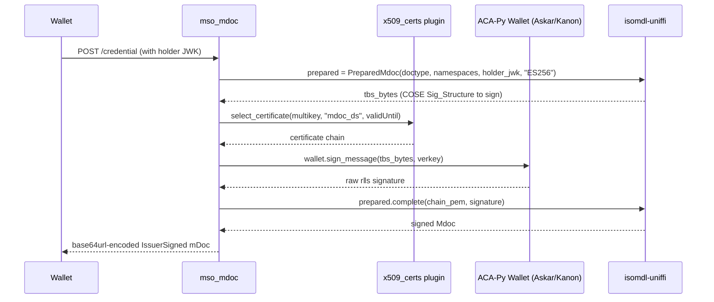

# mso_mdoc

ISO/IEC 18013-5:2021 compliant mobile document (mDoc) credential format for ACA-Py, integrated with the OID4VCI plugin.

## Overview

Issues and verifies mDocs (including mDLs) using the [`isomdl-uniffi`](https://github.com/Indicio-tech/isomdl-uniffi) Rust library via UniFFI bindings. Signing uses the two-step `PreparedMdoc` API so the issuer private key never crosses the FFI boundary — enabling software wallet keys, external-signer (HSM) keys, or any `BaseWallet.sign_message`-compatible backend.

## Installation

`isomdl-uniffi` ships as a platform-specific wheel and must be installed separately:

```bash
# Linux x86_64 (used in Docker)
pip install https://github.com/Indicio-tech/isomdl-uniffi/releases/download/v0.1.0-indicio.1/isomdl_uniffi-0.1.0-py3-none-manylinux_2_17_x86_64.manylinux2014_x86_64.whl

# macOS (Intel/Apple Silicon)
pip install https://github.com/Indicio-tech/isomdl-uniffi/releases/download/v0.1.0-indicio.1/isomdl_uniffi-0.1.0-py3-none-macosx_11_0_universal2.whl
```

## Key Management

The issuer key is a P-256 wallet key, given per exchange as `signing_multikey`. Its document-signer certificate is managed by the `x509_certs` plugin (`--plugin x509_certs`) with purpose `mdoc_ds`.

```
POST /wallet/keys {"alg": "p256"}             →  { multikey }
POST /x509/csr {multikey, subject}            →  CSR to submit to the IACA
POST /x509/certificates {chain, purpose: "mdoc_ds"}
POST /oid4vci/exchange/create {supported_cred_id, credential_subject, signing_multikey}
```

Exchanges without `signing_multikey` are rejected for `mso_mdoc`.

### Signing Flow

isomdl sets the MSO validity (30 days in `isomdl-uniffi` 0.1.0), so the certificate is chosen after the mdoc is prepared: the `mdoc_ds` certificate valid from now through `validUntil`, with the earliest expiry. A self-signed root at the end of the stored chain is not embedded.



## Trust Anchors

Verification uses `x509_certs` trust anchors with purpose `iaca`:

```
POST /x509/trust-anchors {certificate_pem, purpose: "iaca"}
```

## Credential Configuration

Register a supported credential via the OID4VCI routes:

```
POST /oid4vci/credential-supported/create/mso-mdoc
```

Example body:
```json
{
  "format": "mso_mdoc",
  "id": "org.iso.18013.5.1.mDL",
  "doctype": "org.iso.18013.5.1.mDL",
  "cryptographic_binding_methods_supported": ["cose_key"],
  "credential_signing_alg_values_supported": ["ES256"]
}
```

## Module Structure

```
mso_mdoc/
├── cred_processor.py       # MsoMdocCredProcessor: Issuer + CredVerifier + PresVerifier
├── routes.py               # /oid4vci/credential-supported mso-mdoc CRUD routes
├── payload.py              # Payload normalisation for isomdl-uniffi
├── mdoc/
│   ├── issuer.py           # isomdl_mdoc_sign, make_wallet_signer
│   ├── cred_verifier.py    # MsoMdocCredVerifier
│   ├── pres_verifier.py    # MsoMdocPresVerifier
│   ├── mdoc_verify.py      # mdoc_verify helper
│   └── utils.py            # PEM chain helpers
└── tests/
```

## Running Tests

```bash
cd oid4vc
uv run pytest mso_mdoc/tests/ -v
```

