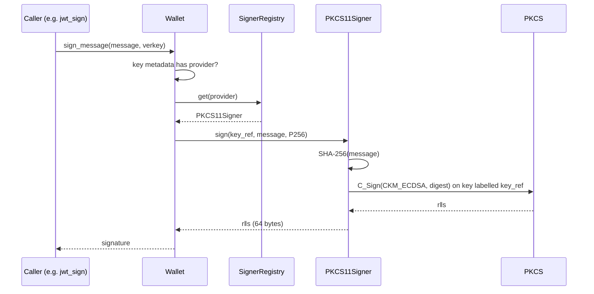

# `pkcs11_signer` design

`pkcs11_signer` keeps ACA-Py signing keys on a PKCS#11 token. It implements ACA-Py's `Signer` protocol and registers it with the `SignerRegistry`; ACA-Py owns key records, key creation routes, and sign dispatch. ACA-Py's `docs/features/ExternalSigners.md` describes the core side.

## Components

| Owner | Component | Role |
|---|---|---|
| ACA-Py | `POST /wallet/keys` (`provider`) | Generates a `key_ref` (UUID), calls `Signer.generate_keypair`, stores the public key with `{provider, key_ref}` metadata |
| ACA-Py | `BaseWallet._get_external_signature` | Sends `sign_message` for keys with `provider` metadata to the registered signer |
| ACA-Py | `SignerRegistry` | Signers by provider name |
| Plugin | `setup()` | Reads `Pkcs11Config`, builds a `PKCS11Signer`, registers it under `provider` |
| Plugin | `PKCS11Signer` | Generates keys, signs, and reads public keys on the token |

```
pkcs11_signer/
├── __init__.py   # setup()
├── config.py     # Pkcs11Config: plugin_config.pkcs11 + PKCS11_* env
└── signer.py     # PKCS11Signer, SignerError
```

The plugin has no admin routes. Certificates for these keys come from ACA-Py's X.509 support (`acapy_agent.x509`, not yet merged), which signs CSRs through `wallet.sign_message` and therefore through this signer.

## Signing flow



## Signer

| Method | Behaviour |
|---|---|
| `generate_keypair(key_ref, key_type)` | Rejects any key type but P-256. Fails if a private key labelled `key_ref` exists, since some tokens (BouncyHsm) don't enforce label uniqueness. Generates with `CKM_EC_KEY_PAIR_GEN`, `CKA_SENSITIVE=true`, `CKA_EXTRACTABLE=false`, `CKA_LABEL=key_ref`. Returns base58 of the SEC1-compressed point, the same form as `aries_askar.Key.get_public_bytes()`. |
| `sign(key_ref, message, key_type)` | Hashes with SHA-256 and signs the digest with `CKM_ECDSA`. Returns raw `r‖s`, the same form as Askar. Rejects multi-message input. |
| `get_public_key(key_ref, key_type)` | Reads the public point for an existing label. Not part of ACA-Py's `Signer` protocol; used by `integration/bouncyhsm/devtools/verify_bouncyhsm.py`. |

### Token selection

The token is found by `token_name`. When `slot` is set, only that slot matches. Exactly one token must match; otherwise startup fails with the list of visible slots and token labels.

### Session pool

`python-pkcs11` sessions can't run overlapping operations, so the signer opens `pool_size` authenticated read-write sessions at startup and lends one to each operation. Further callers wait on an `asyncio.Queue` with no timeout. Blocking PKCS#11 calls run in `asyncio.to_thread`.

If a caller is cancelled during a blocking call, cancellation is delayed until the worker finishes so its session is not reused while busy.

Login happens once per session, at startup. A PIN change or a token restart needs an agent restart; sessions are not reopened.

### Errors

| Situation | Result |
|---|---|
| Unsupported key type, duplicate label, multi-message sign | `WalletError` |
| No key with the label, label matches several objects, other `PKCS11Error` | `SignerError` (subclass of `WalletError`) |
| Key's provider not registered (plugin unconfigured or failed at startup) | `WalletError` from ACA-Py |

`POST /wallet/keys` returns 400 for a `WalletError` raised during key generation.

## Startup

| Configuration | Result |
|---|---|
| Neither `library_path` nor `token_name` set | Warning logged; no signer |
| Missing or invalid value | Error logged; no signer |
| Library or token can't be opened | Exception logged; no signer |
| Valid | `PKCS11Signer` registered under `provider` |
| `provider` already registered by another plugin | `SignerRegistry.register` raises `ValueError` out of `setup()` |

When no signer is registered, signing with a key that names this provider fails, as above.

The `provider` name is written into each key's metadata. Changing it later orphans existing keys.

## Audit

Each `generate_keypair` and `sign` logs one `INFO` record to the `pkcs11_signer.audit` logger, with these fields in `extra`:

| Field | Value |
|---|---|
| `event` | `generate_keypair` or `sign` |
| `provider` | Provider name |
| `key_ref` | Token object label |
| `key_type` | e.g. `p256` |
| `message_digest` | SHA-256 hex of the message (`sign` only) |

Messages, signatures, and the PIN are not logged.

## Key lifecycle

The plugin creates keys and never deletes them. Removing or rotating keys on the token is done with the HSM's own tools.

## Testing

| Suite | Scope |
|---|---|
| Unit (`pkcs11_signer/tests`) | Config resolution, setup, signer logic against a mocked `pkcs11` module |
| Integration (`integration/`) | ACA-Py with the plugin against the BouncyHsm simulator: key generation on the token, JWT signing through wallet dispatch, unconfigured agent |

## Design decisions

| Decision | Reason |
|---|---|
| Dispatch in ACA-Py core, not the plugin | The plugin only handles keys created through it; no wrapping of `BaseWallet` |
| No admin routes | Key creation is `POST /wallet/keys`; certificates come from ACA-Py's X.509 support |
| PKCS#11 only | One protocol per plugin; another backend is a separate plugin registering its own provider |
| Package name `pkcs11_signer` | `python-pkcs11` installs a top-level `pkcs11` module |
| P-256 only | Needed for ES256 / mDL; other curves need ACA-Py key types and token mechanisms |
